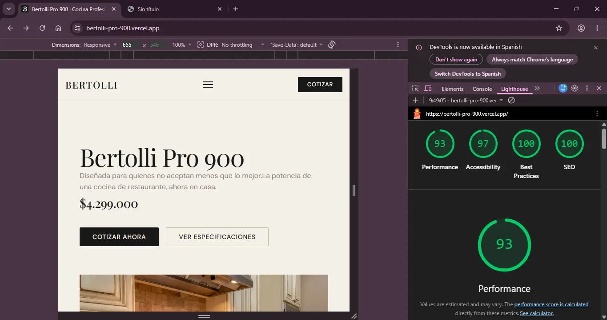

# Bertolli Pro 900

### Landing page premium con inteligencia artificial y backend serverless

Bertolli Pro 900 es un proyecto de portafolio que simula la experiencia digital de una marca de cocinas a gas de alta gama.

El objetivo fue desarrollar una landing page visualmente elegante, funcional y responsive, incorporando funcionalidades reales de desarrollo frontend y backend.

El proyecto combina HTML, CSS y JavaScript vanilla con servicios de Supabase, Vercel y OpenRouter para ofrecer una experiencia interactiva.

**Demo en vivo:** https://bertolli-pro-900.vercel.app

**Repositorio:** https://github.com/AnyelyHuelgos/bertolli-pro-900

> **Aviso:** Bertolli Pro 900 es un producto ficticio creado para demostración. Los precios, especificaciones comerciales, garantías y condiciones de financiación forman parte de la simulación. No se realizan ventas ni pagos reales.

---

## 1. Descripción del proyecto

El proyecto representa una página de producto premium para una cocina a gas de cinco hornillas.

La experiencia está diseñada para que un visitante pueda:

- Conocer el producto y sus características.
- Explorar una galería de imágenes.
- Consultar especificaciones técnicas.
- Resolver dudas mediante preguntas frecuentes.
- Simular cuotas de financiación.
- Enviar un formulario de cotización de demostración.
- Conversar con un asistente virtual impulsado por inteligencia artificial.

La intención fue crear algo más completo que una landing page estática, integrando funcionalidades que requieren comunicación con servicios externos, validaciones y lógica de servidor.

---

## 2. Tecnologías utilizadas

| Tecnología | Uso |
|---|---|
| HTML5 | Estructura semántica |
| CSS3 | Diseño responsive y sistema visual |
| JavaScript | Interactividad y validaciones |
| Node.js | Ejecución de funciones backend |
| Vercel | Despliegue y funciones serverless |
| Supabase | Base de datos PostgreSQL |
| OpenRouter | Integración con modelos de IA |
| Git y GitHub | Control de versiones |
| VS Code | Entorno de desarrollo |

El frontend está desarrollado sin frameworks como React, Angular o Vue.

El backend utiliza servicios y dependencias externas para realizar las operaciones que no deben ejecutarse directamente en el navegador.

---

## 3. Funcionalidades principales

### Landing page responsive

La interfaz está diseñada para adaptarse a diferentes tamaños de pantalla.

Incluye navegación responsive, estructura semántica, imágenes optimizadas y estilos que mantienen la identidad premium del producto.

### Galería interactiva

Permite explorar fotografías del producto mediante un visor de imágenes.

Incluye navegación entre fotografías, controles interactivos y opciones de uso mediante teclado.

### Preguntas frecuentes

Sección FAQ desarrollada con JavaScript.

Los usuarios pueden expandir y contraer respuestas sin recargar la página.

### Calculadora de cuotas

Permite seleccionar diferentes cantidades de cuotas y calcular el valor mensual aproximado.

Las opciones disponibles son:

- 3 cuotas.
- 6 cuotas.
- 12 cuotas.
- 24 cuotas.
- 36 cuotas.

Los cálculos se realizan en JavaScript utilizando un precio demostrativo de $4.299.000 COP.

No representa financiación bancaria real ni constituye una oferta comercial.

### Formulario de cotización

El formulario permite introducir nombre, correo electrónico y mensaje.

Incluye:

- Validación de campos obligatorios.
- Validación del formato de correo electrónico.
- Límites de longitud de los campos.
- Mensajes de error y confirmación.
- Estado de envío.
- Campo honeypot para reducir spam.
- Validación adicional en el servidor.
- Integración con Supabase para almacenar solicitudes.

El backend utiliza una función serverless para recibir los datos y guardarlos en PostgreSQL.

### Bertolli Concierge — Asistente con IA

Bertolli Concierge es un asistente virtual integrado en la página.

Permite realizar preguntas sobre el producto mediante lenguaje natural.

Entre sus funcionalidades se encuentran:

- Integración con OpenRouter.
- Base de conocimiento especializada.
- Respuestas en español.
- Información sobre características y materiales.
- Explicaciones sobre precios demostrativos.
- Información conceptual sobre garantías y accesorios.
- Preguntas rápidas.
- Mensajes de error personalizados.
- Detección de respuestas vacías.
- Segundo intento automático ante determinados fallos del proveedor.
- Límites de uso implementados en el servidor.

El asistente busca mantener un tono profesional, cercano y coherente con una marca premium.

---

## 4. Arquitectura del proyecto

La aplicación utiliza una arquitectura que separa la interfaz pública de las operaciones privadas.

**Frontend**

HTML, CSS y JavaScript se encargan de mostrar la página, gestionar las interacciones y enviar solicitudes al backend.

**Backend**

Las funciones serverless alojadas en Vercel reciben las solicitudes, validan datos y se comunican con los servicios externos.

**Base de datos**

Supabase almacena la información enviada mediante el formulario y proporciona funciones PostgreSQL utilizadas para los controles de frecuencia.

**Inteligencia artificial**

OpenRouter procesa las preguntas del visitante utilizando las instrucciones y la base de conocimiento del asistente.

### Archivos principales

| Archivo | Responsabilidad |
|---|---|
| `index.html` | Estructura de la página |
| `css/tokens.css` | Variables del sistema visual |
| `css/main.css` | Estilos principales |
| `css/components.css` | Estilos de componentes |
| `js/main.js` | Interacciones y formulario |
| `js/chat.js` | Interfaz del asistente |
| `api/agente.js` | API del asistente |
| `api/conocimiento.js` | Base de conocimiento |
| `api/cotizaciones.js` | API de cotizaciones |

---

## 5. Seguridad y validaciones

El proyecto incorpora distintas medidas para reducir errores, abusos y exposición accidental de información.

### Protección de claves

Las credenciales privadas de Supabase y OpenRouter se utilizan desde las funciones del servidor.

No deben incluirse directamente en HTML, CSS o JavaScript público.

### Validación de datos

El formulario valida la información tanto en el navegador como en el backend.

Las validaciones del servidor incluyen tipos de datos, campos obligatorios, longitudes máximas y formato de correo electrónico.

### Protección contra spam

El formulario incorpora un campo honeypot para identificar algunos envíos automatizados.

También se ha agregado un control de frecuencia mediante Supabase, reutilizando la función de limitación con un identificador separado para las cotizaciones.

### Límites del asistente

El asistente utiliza controles de frecuencia implementados con funciones de Supabase:

- Hasta cinco consultas por minuto por identificador.
- Un cupo global configurado de 100 consultas diarias.

Estos controles ayudan a limitar el uso excesivo del servicio de inteligencia artificial.

### Manejo de errores

Las respuestas del backend utilizan códigos HTTP y mensajes de error para comunicar problemas de validación, límites de uso o fallos de servicios externos.

La interfaz presenta mensajes comprensibles para los visitantes.

**Limitación:** Estas medidas reducen determinados riesgos, pero no sustituyen una auditoría de seguridad ni garantizan protección completa frente al spam.

---

## 6. Decisiones de diseño

### Paleta de colores

Quería que la página transmitiera una sensación premium antes de que el visitante leyera el precio.

Por eso elegí una paleta cálida, inspirada en materiales físicos y acabados elegantes.

Los colores principales son:

- Crema: `#f5f0e8`
- Negro carbón: `#1a1a18`
- Dorado suave: `#c8b99a`

El dorado se utiliza como acento en precios, bordes y estados interactivos.

Mis referencias visuales fueron marcas como Smeg y KitchenAid, especialmente por el uso de fondos claros, tipografía elegante y espacios amplios.

### Tipografía

Utilicé Playfair Display para los títulos y DM Sans para el contenido general.

Playfair Display aporta personalidad y elegancia, mientras que DM Sans mantiene una lectura clara en pantalla.

La combinación busca equilibrar una estética premium con la facilidad de uso.

### Espaciado y composición

El espacio en blanco es una parte importante del diseño.

Busqué evitar una interfaz sobrecargada, priorizando la jerarquía visual y la presentación del producto.

Para construir las secciones utilicé CSS Grid y Flexbox según las necesidades de cada componente.

### Diseño responsive

El proyecto utiliza estilos adaptables a distintas resoluciones y tamaños de pantalla.

También incorpora ajustes específicos para el chat en dispositivos móviles, incluyendo tamaños de controles, áreas desplazables y aprovechamiento de la altura disponible.

---

## 7. Accesibilidad

La aplicación incorpora distintas prácticas de accesibilidad:

- Uso de etiquetas HTML semánticas.
- Textos alternativos en imágenes.
- Etiquetas para campos de formulario.
- Atributos ARIA en componentes interactivos.
- Navegación mediante teclado.
- Cierre de determinados componentes con Escape.
- Indicadores visuales de foco.
- Mensajes de estado y error.
- Adaptación a preferencias de movimiento reducido en componentes del chat.

Estas medidas deben complementarse con pruebas manuales y herramientas especializadas para evaluar el nivel de accesibilidad real.

---

## 8. Rendimiento y optimización

Durante el desarrollo se aplicaron distintas técnicas orientadas al rendimiento:

- Imágenes en formato WebP.
- Carga diferida de imágenes de la galería.
- Priorización de la imagen principal.
- Scripts con atributo `defer`.
- Precarga y optimización de recursos seleccionados.
- Inicialización diferida de algunas interacciones mediante IntersectionObserver.
- CSS responsive.

El objetivo es ofrecer una experiencia fluida sin utilizar un framework frontend.

### Lighthouse

El proyecto cuenta con una medición anterior documentada en el repositorio:

| Categoría | Resultado anterior |
|---|---:|
| Performance | 93 |
| Accessibility | 97 |
| Best Practices | 100 |
| SEO | 100 |

Estos resultados corresponden a una auditoría previa. No deben interpretarse como una medición verificada de la versión actual.

Después de los cambios recientes es necesario ejecutar nuevamente Lighthouse.

---

## 9. Mi flujo de desarrollo con inteligencia artificial

La inteligencia artificial fue una herramienta de apoyo durante el desarrollo, especialmente para generar alternativas, resolver problemas y acelerar tareas concretas.

### ¿Qué partes desarrollé manualmente?

Construí la estructura principal de las secciones de inicio, características y especificaciones.

También trabajé en la composición visual del hero, el grid de características y los estilos del formulario.

El acordeón de preguntas frecuentes fue una de las funcionalidades que desarrollé manualmente para practicar JavaScript y comprender su funcionamiento.

### ¿Cómo utilicé la IA?

Utilicé Claude como apoyo para desarrollar contenido ficticio, proponer estructuras visuales y resolver dificultades de implementación.

También recibí asistencia para mejorar interacciones, validaciones, la calculadora de cuotas y la galería de imágenes.

Posteriormente utilicé ChatGPT para ampliar el proyecto con funcionalidades backend, integración de Supabase, configuración de OpenRouter, controles de seguridad y mejoras de Bertolli Concierge.

La IA ayudó a acelerar el trabajo, pero fue necesario revisar el código, corregir errores y probar las funcionalidades.

### ¿Qué sugerencias de IA descarté?

Durante el proceso descarté algunas propuestas que añadían complejidad innecesaria o no encajaban con la identidad visual.

Por ejemplo, preferí mantener un sistema de variables CSS manejable y un footer más limpio, en lugar de utilizar alternativas demasiado extensas o recargadas.

### ¿Qué aprendí?

Uno de los aprendizajes principales fue que el código generado por IA también requiere validación.

La galería fue un ejemplo importante: una implementación inicial presentaba problemas visuales y funcionales que solo se detectaron al probarla en el navegador.

Esto reforzó la importancia de revisar el resultado real y comprender los cambios antes de publicarlos.

---

## 10. Retos técnicos del proyecto

### Integración con una base de datos

El formulario pasó de ser una interacción frontend a comunicarse con una función backend que almacena información en Supabase.

Esto permitió practicar validación de solicitudes, manejo de respuestas HTTP, variables de entorno y operaciones de base de datos.

### Integración de inteligencia artificial

La creación de Bertolli Concierge implicó conectar la aplicación a un proveedor externo, estructurar instrucciones y desarrollar una base de conocimiento.

También fue necesario manejar respuestas vacías y errores del proveedor.

### Seguridad en funciones serverless

El proyecto permitió trabajar con separación entre cliente y servidor, protección de claves y controles de frecuencia basados en Supabase.

### Experiencia de usuario

Uno de los objetivos fue conseguir que las funcionalidades técnicas se integraran con el diseño premium sin afectar la facilidad de uso.

---

## 11. Instalación y ejecución local

### Requisitos

- Node.js y npm.
- Git.
- Un editor como Visual Studio Code.
- Acceso a un proyecto de Supabase configurado.
- Una clave de OpenRouter.
- Acceso a Vercel para trabajar con las funciones serverless.

### Instalación

Clonar el repositorio:

`git clone https://github.com/AnyelyHuelgos/bertolli-pro-900.git`

Entrar a la carpeta:

`cd bertolli-pro-900`

Instalar dependencias:

`npm install`

### Variables de entorno

El backend utiliza las siguientes variables:

- `SUPABASE_URL`
- `SUPABASE_SECRET_KEY`
- `OPENROUTER_API_KEY`

Sus valores deben configurarse mediante un archivo local de entorno o en el entorno de ejecución.

No se deben subir credenciales reales a GitHub.

### Ejecución

Para visualizar solamente la interfaz se puede utilizar Live Server.

Para probar las funciones backend localmente puede utilizarse Vercel CLI:

`npx vercel dev`

La ejecución de Vercel CLI puede requerir autenticación, vincular el proyecto y configurar las variables de entorno correspondientes.

La estructura y las funciones necesarias de Supabase también deben estar configuradas.

---

## 12. Despliegue

El proyecto está alojado en Vercel y conectado con GitHub.

Los cambios publicados en la rama `main` pueden iniciar despliegues automáticos de producción, según la configuración del proyecto.

Las variables de entorno privadas se administran desde Vercel.

Antes de publicar cambios importantes, es necesario comprobar la sintaxis, revisar las modificaciones y verificar que no se hayan incluido secretos.

---

## 13. Pruebas y comprobaciones

Durante el desarrollo se realizaron pruebas manuales de distintas funcionalidades de la interfaz.

Entre las comprobaciones históricas documentadas se encuentran:

- Navegación responsive.
- Apertura y cierre del menú.
- Navegación por la galería.
- Funcionamiento del FAQ.
- Validación de campos del formulario.
- Actualización de la calculadora de cuotas.

También se comprobaron respuestas del asistente virtual en el entorno desplegado.

### Comprobaciones pendientes para la versión final

- Verificar el formulario completo contra Supabase.
- Comprobar los límites de frecuencia del formulario.
- Comprobar los límites diarios y por minuto del asistente.
- Probar errores de conexión y respuestas vacías.
- Revisar el chat con teclado virtual en dispositivos reales.
- Realizar una auditoría Lighthouse actualizada.
- Revisar accesibilidad con teclado y lector de pantalla.

No se consideran superadas estas pruebas hasta ejecutarlas sobre la versión final.

---

## 14. Limitaciones del proyecto

Bertolli Pro 900 es una demostración técnica y visual.

No es una tienda comercial operativa.

Los precios, garantías, políticas comerciales y determinadas especificaciones del producto son ficticios.

El formulario representa una experiencia de solicitud de cotización, no una operación de venta.

El asistente depende de la disponibilidad de OpenRouter y de los límites configurados.

Las medidas de seguridad implementadas constituyen una base inicial y pueden ampliarse para aplicaciones con tráfico real.

---

## 15. Posibles mejoras futuras

Entre las funcionalidades que podrían incorporarse más adelante se encuentran:

- Pruebas automatizadas.
- Monitoreo de errores.
- Mejoras adicionales contra spam.
- Comparador de productos.
- Panel de administración para solicitudes.
- Historial de conversaciones del asistente.
- Nuevas opciones de accesibilidad.
- Auditorías periódicas de rendimiento.

Estas funcionalidades están fuera del alcance de la versión actual.

---

## Conclusión

Bertolli Pro 900 comenzó como una landing page frontend y evolucionó hacia una aplicación demostrativa con backend, base de datos e inteligencia artificial.

El proyecto me permitió aplicar conocimientos de estructura HTML, diseño responsive, JavaScript, consumo de APIs, funciones serverless, integración con bases de datos y despliegue.

También fue una oportunidad para practicar la resolución de problemas, utilizar herramientas de inteligencia artificial de manera crítica y comprender la importancia de probar el código antes de publicarlo.

Mi objetivo fue crear un proyecto visualmente atractivo, pero también demostrar cómo una interfaz puede conectarse con servicios reales y ofrecer una experiencia más completa.

**Bertolli Pro 900 — Proyecto de portafolio de desarrollo web.**